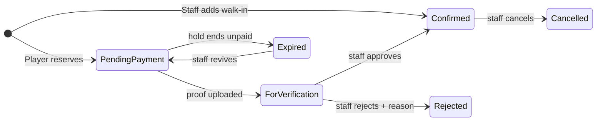

# Serve Pickleball Yard — Court Booking PRD

Last updated: Nov 18, 2026 · Living version: https://claude.ai/artifact/QcqZbwm8pHWDE2eQuzZgUL

## Overview

Players book Serve's 2 indoor courts online by the hour, pay ₱400/hour by GCash or Maya QR, and staff confirm each payment by hand. Phase 1 (booking, payment checks, reports) is live. Open play payments (sessions, a payment link for Reclub, walk-ins, refunds, and open play in reports) are built. The open play game queue is not started.

**Problem.** Bookings today depend on staff answering messages and tracking slots by hand. Double bookings, unpaid holds, and no view of sales or peak hours are the result.

**Goals**

- Players can see free hours and reserve one without messaging staff.
- No court-hour is ever booked twice.
- Unpaid reservations release themselves so slots don't sit blocked.
- Staff confirm or reject payments in one place.
- Admins see sales and the busiest hours and seasons.

**Success measures** (targets to confirm with the owner)

- Share of bookings made online instead of by message or walk-in.
- Median time from payment upload to staff confirmation.
- Holds that expire unpaid, as a share of all online bookings.
- Court utilization: hours booked ÷ bookable hours.

**Not in phase 1:** player accounts, automatic payment verification, email or SMS notifications, refunds for court bookings, discounts or memberships, and different rates by time of day.

## Users and roles

There are three roles. Players use the public site with no account. Staff and admins sign in to the backoffice with an email and password that an admin creates.

| Capability | Player | Staff | Admin |
| --- | --- | --- | --- |
| See hours, rates, and availability | Yes | Yes | Yes |
| Book online and upload payment proof | Yes | — | — |
| Check a booking by reference | Yes | Yes | Yes |
| Approve, reject, or cancel bookings | — | Yes | Yes |
| Extend or revive a payment hold | — | Yes | Yes |
| Add walk-in or phone bookings | — | Yes | Yes |
| Block and unblock hours | — | Yes | Yes |
| Sales report and CSV export | — | — | Yes |
| Analytics (peak hours, seasons, utilization) | — | — | Yes |
| Settings (rate, hours, holds, QR codes) | — | — | Yes |
| Manage staff and admin accounts | — | — | Yes |

Players give a name, a PH mobile number (09XXXXXXXXX), and an email. They get a booking reference like SPY-7K3QXM to check status later. An admin can't change their own role or deactivate themselves.

## Hours, rates, and booking rules

The courts open at 4AM and close at 1AM, in three bands, all at ₱400 per hour per court. Admins can change every value below in Settings.

| Band | Hours | Booking notice | Rate |
| --- | --- | --- | --- |
| Early bird | 4AM – 9AM | At least 24 hours ahead | ₱400/hr |
| Regular | 9AM – 10PM | Anytime before the hour starts | ₱400/hr |
| Late night | 10PM – 1AM | At least 24 hours ahead | ₱400/hr |
| Closed | 1AM – 4AM | Not bookable | — |

Rules:

1. Bookings are whole hours that start on the hour. There are no half hours and no :30 starts.
2. A player picks 1 to 12 hours on one court per booking. The hours don't have to be next to each other.
3. Players can book up to 8 weeks ahead, counted in whole days from today.
4. An hour that has already started can't be booked.
5. Each court-hour has at most one active booking. The database enforces this.
6. A day runs from 4AM to 1AM. The 12AM–1AM hour belongs to the evening before it in the grid and in reports.
7. All times are Philippine time (UTC+8).
8. Staff walk-in bookings skip the 24-hour notice and the 8-week window, but can't be in the past or in closed hours.
9. A rate change applies to new bookings only. Existing bookings keep the rate they were made at.

## Public site

The public site has four pages, and players never need an account.

**Home (`/`)**

- A hero section with the court photo, the tagline "Play with purpose," and a Book a court button.
- Cards for the three hour bands with the rate.
- A card per court, each linking to its booking grid.
- How booking works in four steps: pick hours, reserve, pay by QR, get confirmed.

**Booking (`/book`)**

- Court 1 and Court 2 tabs.
- A 7-day grid starting today, with Prev and Next to move through the 8-week window.
- Rows are hours from 4AM to 12AM, grouped under Early bird, Regular hours, and Late night labels.
- Cell states:
  - Available (court blue)
  - Selected (lime)
  - On hold (orange)
  - Booked (gray)
  - Blocked (dark stripes)
  - Open play (navy with a lime ball): hours staff set aside for open play sessions, which players can't book privately
  - Not bookable (light gray), with a hover note saying why
- A summary panel shows the chosen hours grouped into runs ("Mon Nov 16 · 3PM–5PM") and the total.
- The player enters name, mobile, and email, then taps Reserve and pay.
- On phones, a sticky bar shows the hours and total with a Continue button.
- If an hour is taken while the player is choosing, they see an error and the grid refreshes.

**Payment (`/book/<ref>/pay`)**

- The GCash and Maya QR codes with account names and numbers. Until an admin uploads the codes, a "QR code coming soon" note shows instead.
- The amount due, and the booking reference to put in the payment note.
- A live countdown to the end of the hold.
- A form for the payment method, the receipt reference number, and a screenshot (JPG, PNG, or WEBP, up to 5MB).

**Booking status (`/booking` and `/booking/<ref>`)**

- Players look up a booking by reference.
- The page shows the court, hours, total, and status, plus the rejection reason if there is one.
- The status page shows the player's first name only. Mobile number and email are never shown publicly.

## Booking and payment flow

An online booking holds its hours while the player pays, and becomes confirmed only when staff approve the payment. Walk-in bookings start as confirmed.

- **Pending payment:** the hours are held for 30 minutes and show as On hold to other players. Staff can extend the hold, or approve straight away if the player paid at the desk.
- **For verification:** the player uploaded proof. The hold no longer runs out until staff act.
- **Confirmed:** counts in sales and analytics.
- **Expired:** the hold ended without proof, and the hours become free immediately. Staff can revive it if the hours are still free and haven't started.
- **Rejected:** the player sees the reason, and the hours become free.
- **Cancelled:** staff cancelled a confirmed booking, and the hours become free.

## Backoffice for staff and admins

Staff work from two pages: a bookings queue for checking payments and a schedule for walk-ins and blocks. Every action is recorded in an audit log with who did it and when.

**Bookings queue (`/backoffice`)**

- Tabs by status: For verification, Waiting for payment, Confirmed, Rejected, Expired, and Cancelled. The first two show counts.
- For verification is sorted oldest upload first. Waiting for payment is sorted by soonest hold expiry.
- Search by reference, name, or mobile number.
- Each row shows the reference, player and contact, court and hours, total, payment method and receipt number, and the hold countdown.
- Actions:
  - **View proof:** opens the screenshot through a private link that lasts 10 minutes.
  - **Approve:** confirms the booking.
  - **Reject:** requires a reason, which the player sees.
  - **Cancel:** for a booking that's already confirmed.
  - **+30 min / +2 hrs:** extends a payment hold.
  - **Revive hold 30 min:** restores an expired booking if its hours are still free and haven't started.
- The sidebar shows a badge with the number of bookings waiting for verification.

**Schedule (`/backoffice/schedule`)**

- The same grid as the public site, with player first names or block reasons inside the cells. Staff can go to past weeks and up to a year ahead.
- Tap free hours to either:
  - Reserve for a walk-in or phone player (name, mobile, and paid in cash, GCash, or Maya). The booking is confirmed right away.
  - Set them as open play, with an optional note such as the fee per player. Or block them with a reason, such as maintenance or a private event.
- Tap open play or blocked hours to make them bookable again. Hours that belong to an open play session can't be freed here; tapping them links to the session.
- Tap a booking to see its reference, contact, status, and total, with a link to it in the queue.

## Admin features

Admins get four more pages. Reports count confirmed bookings and approved open play payments, by play date in Philippine time.

**Sales report (`/backoffice/reports/sales`)**

- Date ranges: This week, This month, Last month, Last 90 days, Last 12 months, or custom dates.
- Totals: overall revenue (after open play refunds), court rentals (hours and bookings), and open play (players and sessions).
- A reminder linking to sessions with open play refunds still owed.
- Breakdowns: court rentals by court, and all sales by payment method (GCash, Maya, cash) and by channel (online or walk-in), each with its share of revenue.
- A daily table with rental revenue per court, hours, open play revenue and players, refunds, and the day's total.
- CSV export: date, type (court_rental, open_play, open_play_refund), court, payment method, channel, bookings, players, hours, revenue in PHP.

**Analytics (`/backoffice/reports/analytics`)**

- The same date ranges, defaulting to the last 12 months.
- Summary cards: overall utilization, peak slot (for example Fri 9PM), busiest day, and best month.
- A peak-hours heatmap of day of week by start hour.
- Monthly hours booked, to show busy and slow seasons, with the best month highlighted.
- Weekly hours booked, with weeks starting Monday.
- Utilization per court: hours booked ÷ (21 bookable hours × days in range).
- Open play: sessions held, players, average per session, fill rate, and a table of sessions in the range. The heatmap and utilization stay court rentals only.

**Settings (`/backoffice/settings`)**

- Rate per hour, payment hold length (5–1,440 minutes), booking window (1–52 weeks), and early bird and late night notice (0–168 hours).
- Court hours: when early bird opens, when regular and late night start, and closing time after midnight. They must stay in that order.
- GCash and Maya QR images (PNG, JPG, or WEBP, up to 2MB) with account names and numbers.
- Open play: fee per player (₱120) and players per court (12). Changes apply to sessions created afterwards.

**Users (`/backoffice/users`)**

- Add a user with a name, email, temporary password (10+ characters), and role.
- Change a role between staff and admin.
- Deactivate or reactivate a user. Deactivating signs them out right away.

## Security, reliability, and design

Access rules are enforced in the database, not only in the screens, so hiding a menu item is never the only protection.

| Area | Requirement | How it's met |
| --- | --- | --- |
| Double booking | Two players can never hold the same court-hour | A unique database index on active court-hours. 5 players booking the same hour at once gave exactly 1 success. |
| Role access | Staff can't see reports, settings, or users, and can't promote themselves | Row-level security plus role checks inside every database function. Tested with `npm run check:permissions`. |
| Public data access | The public site can't read or write tables directly | Only server-side functions with fixed inputs are used. Player contact details are never returned publicly. |
| Payment screenshots | Proofs are private | Stored in a private bucket. Staff view them through 10-minute signed links. |
| Rule consistency | The screens and the database agree on what's bookable | The same rules exist in the app (`lib/schedule.ts`, 16 tests) and in SQL (`validate_slot`). |
| Holds | Unpaid holds free up their hours | Expired holds stop counting immediately, and a job marks them expired every 5 minutes. |
| Time zone | Every date and hour is Philippine time | UTC+8 throughout the app and the database. |
| Mobile | Players can book from a phone | Tested at 375px width with no sideways scrolling, plus a sticky summary bar. |

**Brand.** Colors come from the court and logo:

- Court blue #1F5FBF for primary actions and available hours.
- Kitchen gray #A7ADB5 for booked hours.
- Surround orange #D98A4E for calls to action and holds.
- Ball lime #C8E63C for selected hours.
- Steel #2B2F36 for the nav.

Headings use Oswald and body text uses Inter. Blue panels carry white court lines.

**Tech stack:** Next.js 16, Supabase (Postgres, Auth, Storage, pg_cron), Tailwind CSS 4, and Recharts. Hosting target: Vercel and Supabase.

## Open play

Players register for open play in Reclub. Our site handles the money: each session has a payment link that goes into the Reclub registration, and staff accept players from the Reclub waiting list once their payment is confirmed. Design: `docs/superpowers/specs/2026-11-18-open-play-payments-design.md`.

**Sessions (`/backoffice/open-play`, staff and admins)**

- Create a session with a date, start and end time (whole hours, including late night), and courts. The court-hours are closed to private booking. Open play marks already on the schedule are taken over.
- Each session saves the fee and players per court at creation, so later Settings changes don't affect it. Limit = players per court × courts.
- The session page shows the payment link (with Copy link), players paid against the limit, and every payment with its status.
- Add walk-in players who paid at the yard (cash, GCash, or Maya; mobile optional for cash) while spots are left.
- Add a court to raise the limit. To change the date or time, cancel and create a new session.
- Cancel a session before it starts. Payments already sent become Refund owed until staff mark them refunded; unpaid ones are cancelled.

**Payment link (`/open-play/<code>`)**

- Shows the session, fee, and spots left. One payment covers 1–12 players (never more than the spots left), each named as shown in Reclub, plus the payer's mobile and optional email.
- Spots are held during the payment hold (30 minutes) and while the screenshot is being checked. Two players can't both take the last spot.
- The link stops taking payments when the session starts, and shows when a session is full or cancelled.
- Payment works like court bookings: GCash or Maya QR, screenshot upload, reference `SPY-OP-XXXX`. "My booking" shows open play status too.

**Checking payments:** open play payments appear in the Bookings list with an Open play tag and count in the sidebar badge. Approve, reject, and extend hold work as for bookings.

**Next: game queue (not started).** A "who's up next" board for a TV and court assignment as courts free up. The rotation rules still need to be decided.

## Open questions

- [ ] Open play rotation: next 4 in line, winners stay (and for how many games), or paddle stack by groups?
- [x] Open play fee: collected through the app's payment link (or at the desk for walk-ins).
- [ ] Should players get booking confirmations by email or SMS?
- [ ] Cancellation and refund policy for confirmed bookings.
- [ ] Targets for the success measures in the Overview.
- [ ] Production setup: Supabase project, domain name, first admin account, and the real GCash and Maya QR codes.
