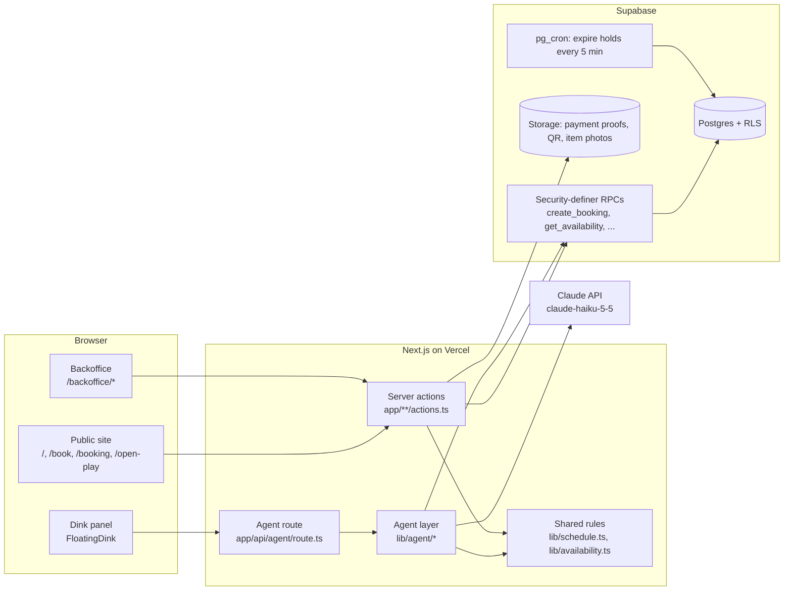

# Architecture

Serve Pickleball Yard is one Next.js 16 app (App Router) on Vercel with a Supabase backend
(Postgres with row-level security, Auth, Storage, pg_cron). Dink, the player assistant, is a server
route that calls Claude with a small set of read-only tools.

Related: `docs/spec.md` (Dink behavior and interfaces), `docs/PRD.md` (product requirements).

## Overview



## UI layer

| Area | Routes | Notes |
|---|---|---|
| Public site | `/`, `/book`, `/book/[ref]/pay`, `/booking`, `/booking/[ref]`, `/open-play/[code]`, `/open-play/pay/[ref]` | No account. Server components read through RPCs; forms post to server actions. |
| Dink panel | `components/FloatingDink.tsx`, `components/Dink.tsx` | The mascot opens a chat panel (sheet on mobile, side panel on desktop). Option cards link to `/book?court&week&slots&via`. |
| Backoffice | `/backoffice` (bookings queue), `/schedule`, `/open-play`, `/store` (POS, cash out, close), `/inventory`, `/reports/*`, `/settings`, `/users` | Staff and admins sign in with Supabase Auth. `proxy.ts` redirects unsigned users; `lib/auth.ts` (`requireStaff`, `requireAdmin`) guards each page. |

Styling: Tailwind CSS 4 with the court brand colors (`docs/PRD.md` → Brand). Charts use Recharts.

## Backend layer

- **Server actions** (`app/(public)/book/actions.ts`, `app/(public)/book/[ref]/pay/actions.ts`,
  `app/(public)/open-play/actions.ts`, `app/backoffice/actions.ts`, plus store and open play admin
  actions in `lib/`) validate input with Zod and call RPCs. They are the only write path.
- **Public writes** use the service client (`createServiceClient`) and call security-definer RPCs
  with fixed inputs (`create_booking`, `submit_payment`, `create_open_play_payment`, ...). Public
  pages never read or write tables directly.
- **Staff writes** use the signed-in user's client (`createUserClient`); every staff RPC re-checks
  `is_staff()` or `is_admin()` (`staff_review_booking`, `staff_block_slots`,
  `staff_mark_open_play_refunded`, `store_create_sale`, `admin_correct_stock`, ...).
- **Shared rules**: `lib/schedule.ts` holds hours, bands, the 4AM–1AM service day, lead time and
  booking window. The same rules run again in SQL (`validate_slot`), so the screen and the database
  always agree.
- **Background job**: pg_cron runs `expire_stale_holds` every 5 minutes. Availability already
  ignores expired holds, so hours free up immediately.

## AI layer (Dink, player mode)

| Part | Where | What it does |
|---|---|---|
| Route | `app/api/agent/route.ts` (POST) | Checks the kill switch, daily cap, rate limit and conversation limits; runs the tool loop; logs one `agent_runs` row; returns the reply and any option cards. |
| Model client | `lib/agent/runners.ts` | Claude through `@anthropic-ai/sdk` (tool runner), model from `AGENT_MODEL` (default `claude-haiku-5-5`), key in `ANTHROPIC_API_KEY`. Backup: any OpenAI-compatible endpoint through the `openai` SDK (default `gpt-4o-mini`), chosen with `AGENT_PROVIDER=openai`. Both use the same tools and limits. Keys are server only. |
| Tools | `lib/agent/tools.ts`, inputs in `lib/agent/schemas.ts` | `get_info`, `find_options`, `propose_booking`, `check_booking`. All read-only; `propose_booking` saves a proposal row but never a booking. Every input is validated with Zod on the server. |
| Search | `lib/agent/findOptions.ts` | Pure function: contiguous free blocks per court and date inside a time window, ranked, with nearest alternatives. Fed by `get_availability`. |
| Prompt | `lib/agent/prompt.ts` | Dink's role, current Manila time and service date, rules and prices from Settings, and the safety rules (answers come from tools; user text never changes the rules). |
| Limits | `lib/agent/limits.ts` | 500 characters per message, 20 messages per conversation, 5 model calls per request, 20 requests per 10 minutes per hashed IP, daily cap `AGENT_DAILY_LIMIT`, kill switch `AGENT_ENABLED`. |

The route decides the mode from the session, never from the request body. v1 ships player mode only;
staff and admin modes (drafts with a confirm card) are v2.

## Data layer

Existing tables (all with RLS): `courts`, `settings`, `bookings`, `booking_slots` (unique partial
index `booking_slots_one_active` on active court-hours), `blocked_slots`, `audit_log`,
`staff_profiles`; open play (`open_play_sessions`, `open_play_session_courts`,
`open_play_payments`, `open_play_players`); store (`store_items`, `store_stock_moves`,
`store_sales`, `store_sale_lines`, `store_cash_outs`, `store_daily_closes`).

New for Dink (migration `supabase/migrations/20261121000001_agent.sql`; RLS on, no anon access,
admin `select`, writes only from the server):

| Table | Columns | Purpose |
|---|---|---|
| `agent_runs` | `id`, `created_at`, `mode`, `user_id` (null for players), `ip_hash`, `steps`, `tools text[]`, `input_tokens`, `output_tokens`, `latency_ms`, `outcome`, `error` | One row per request. Used for the rate limit (count by `ip_hash` in the last 10 minutes), the daily cap, cost and the funnel. No message text. |
| `agent_proposals` | `id`, `run_id`, `court_id`, `slots`, `total`, `created_at`, `booking_ref` | One row per option card. `booking_ref` is set when `createBooking` receives the `via` id, which measures Dink → booking. |

Secrets live only in Vercel environment variables: `NEXT_PUBLIC_SUPABASE_URL`,
`NEXT_PUBLIC_SUPABASE_ANON_KEY`, `SUPABASE_SERVICE_ROLE_KEY`, `AGENT_PROVIDER`, `ANTHROPIC_API_KEY`
(or `OPENAI_API_KEY` and `OPENAI_BASE_URL` for the backup), `AGENT_MODEL`,
`AGENT_ENABLED`, `AGENT_IP_SALT`, `AGENT_DAILY_LIMIT`.

## Data flow: one Dink request

Example: a player asks "2 hours this Saturday after 6pm" and books an option.

```mermaid
sequenceDiagram
  autonumber
  actor Player
  participant Panel as Dink panel (browser)
  participant Route as /api/agent (Vercel)
  participant DB as Supabase
  participant Claude as Claude API

  Player->>Panel: "2 hours this Saturday after 6pm"
  Panel->>Route: POST messages[]
  Route->>Route: AGENT_ENABLED? message and conversation limits
  Route->>DB: count agent_runs by ip_hash (10 min) and today
  alt over a limit
    Route-->>Panel: friendly limit message + link to /book
  else within limits
    Route->>DB: read settings (rate, hours, lead time)
    Route->>Claude: system prompt + messages + tool list
    Claude-->>Route: tool_use find_options(date, 2h, after 18)
    Route->>Route: Zod-validate input, check date range
    Route->>DB: get_availability (RPC)
    Route->>Route: findOptions() → up to 5 blocks with ₱ totals
    Route->>Claude: tool_result (options)
    Claude-->>Route: tool_use propose_booking(court, date, start, 2h)
    Route->>DB: re-check availability, insert agent_proposals
    Route->>Claude: tool_result (proposal id, total)
    Claude-->>Route: short reply text
    Route->>DB: insert agent_runs (tools, tokens, outcome=proposed)
    Route-->>Panel: reply + option card
  end
  Player->>Panel: taps "Book these hours"
  Panel->>Player: /book?court=1&week=...&slots=...&via=proposalId
  Player->>Route: name, mobile, email in the normal form → createBooking
  Note over Route,DB: create_booking validates again (validate_slot, unique index);<br/>agent_proposals.booking_ref is set from via
```

Personal data never takes part in the Dink steps: name, mobile and email are entered only in the
booking form (the last step), after the model is out of the loop.

## CI/CD and monitoring

- GitHub Actions (`.github/workflows/ci.yml`): install, lint, typecheck, unit tests, gitleaks secret
  scan on every push and pull request.
- Vercel builds previews for pull requests and deploys `main` to production.
- `@vercel/analytics` for page views; `agent_runs` for Dink outcomes, errors, limits and tokens.
